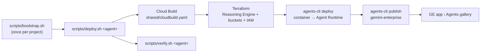

# Telix 2b — Deployed AI Champions: Life-Sciences Agents on Gemini Enterprise

Three production-ready [ADK](https://github.com/google/adk-python) agents, each deployed to
**Agent Runtime** (Gemini Enterprise Agent Platform) and registered as a custom agent in a
**Gemini Enterprise (GE)** app — with one script per step.

| Agent | What it does | Deploy guide |
| --- | --- | --- |
| [**BioCompass**](biocompass-agent/) | Biomedical literature research: PubMed, Europe PMC, bioRxiv/medRxiv, ClinicalTrials.gov, PubTator3 entity analysis, deep-research pipeline, concept figures, 6 pharma methodology skills (PICO, PRISMA, MoA, …). | [biocompass-agent/DEPLOY.md](biocompass-agent/DEPLOY.md) |
| [**PaperBanana**](paperbanana-agent/) | Turns a paper section / data / sketch into a publication-quality figure via a plan → stylize → render → critique → refine loop (Gemini + Nano Banana Pro, up to 4K). | [paperbanana-agent/DEPLOY.md](paperbanana-agent/DEPLOY.md) |
| [**Argus**](argus-agent/) | Life-sciences M&A due diligence: quick questions via specialist sub-agents, target screening from a thesis, deep-diligence pipeline producing whitepaper PDFs with charts. Uses SEC EDGAR + Agent Registry Science Skills. | [argus-agent/DEPLOY.md](argus-agent/DEPLOY.md) |

Upstream source: [`soheilage/LifeSciences › applications/pharma-on-gemini-enterprise`](https://github.com/soheilage/LifeSciences/tree/main/applications/pharma-on-gemini-enterprise)
(Apache-2.0). Agent code is copied unchanged; only the Terraform module path and the
deployment automation were adapted so this repository is self-contained.

---

## How a deployment works



Everything runs **inside Cloud Build** under a dedicated deployer service account, so your
laptop only needs `gcloud`. Terraform state lives in a GCS bucket, which makes every script
idempotent: re-running `deploy.sh` updates the same Reasoning Engine and GE registration.

## Quick start (all three agents)

```bash
git clone https://github.com/soheilage/Telix-2b-deployed-ai-champions.git
cd Telix-2b-deployed-ai-champions

# 0. Tools: gcloud (with alpha), uv, git, python3  — see "Prerequisites"
gcloud auth login

# 1. Configure
cp .env.example .env            # edit PROJECT_ID / REGION / EDGAR_USER_AGENT

# 2. One-time project bootstrap (APIs, deployer SA, state bucket, GE app auto-detect)
scripts/bootstrap.sh

# 3. Deploy + register  (≈10–20 min each; sequential on purpose)
scripts/deploy.sh biocompass
scripts/deploy.sh paperbanana
scripts/deploy.sh argus          # also syncs Science Skills to Agent Registry
#   …or: scripts/deploy_all.sh

# 4. Verify
scripts/verify.sh all --smoke
```

Then open **Gemini Enterprise → your app → Agents** — all three agents appear in the gallery.

## Prerequisites

| Requirement | Why |
| --- | --- |
| A GCP project with billing and a **Gemini Enterprise app** (Console → *Gemini Enterprise* → *Apps*) | Agents are registered into this app. `bootstrap.sh` auto-detects it (global / us / eu). |
| `roles/owner` (or Editor + Project IAM Admin + Service Usage Admin) on the project | `bootstrap.sh` creates a service account, grants roles and enables APIs. |
| [`gcloud`](https://cloud.google.com/sdk/docs/install) ≥ 500 with `alpha` (`gcloud components install alpha`) | Builds, IAM, Agent Registry (Argus). |
| [`uv`](https://docs.astral.sh/uv/) | Runs the Science-Skills sync (Argus) and the optional smoke test. |
| `git`, `python3`, `curl` | Scripts. |
| Gemini 3 model access on the **global** endpoint in your project | All agents use `gemini-3.x` + `gemini-3-pro-image` (see each `.env.example`). |

> **Region choice.** Keep Agent Runtime in the same geography as the GE app
> (`eu` app → `europe-west4`, `us`/`global` app → `us-central1`). Set `REGION` in `.env`.

## Repository layout

```
.env.example                 # shared configuration (copy to .env)
scripts/
  bootstrap.sh               # one-time project setup (idempotent)
  deploy.sh <agent>          # Cloud Build: Terraform → agents-cli deploy → GE publish
  deploy_all.sh              # the three agents in sequence
  verify.sh <agent|all>      # Reasoning Engine + GE registration check, optional --smoke
  sync_science_skills.sh     # Argus prerequisite (Agent Registry skills)
  teardown.sh <agent>        # unregister + terraform destroy
shared/
  cloudbuild.yaml            # the pipeline (unchanged from upstream apart from comments)
  cloudbuild-destroy.yaml    # teardown pipeline
  terraform/agent-infrastructure/   # Reasoning Engine w/ Agent Identity, logs bucket, IAM
  scripts/sync_skills_to_registry.py
biocompass-agent/            # README.md (architecture, local dev)  +  DEPLOY.md (step-by-step)
paperbanana-agent/
argus-agent/
```

## Operating the agents

| Task | Command |
| --- | --- |
| Redeploy after a code change | `scripts/deploy.sh <agent>` |
| Change a runtime setting (e.g. image size) | set `<AGENT>_EXTRA_ENV` in `.env`, redeploy |
| Deploy without touching GE | `scripts/deploy.sh <agent> --no-register` |
| Kick off and return immediately | `scripts/deploy.sh <agent> --async`, then `gcloud builds list` |
| Logs | `gcloud logging read 'resource.type="aiplatform.googleapis.com/ReasoningEngine"' --project=$PROJECT_ID --limit=50` |
| Remove an agent | `scripts/teardown.sh <agent>` |

## Troubleshooting

| Symptom | Fix |
| --- | --- |
| `bootstrap.sh`: *No Gemini Enterprise app found* | Create the app in the Console first, or set `GE_APP_ID` manually in `.env`. |
| Cloud Build fails in `tf-apply` with `403` | The deployer SA roles were just granted – IAM can take 1–2 min to propagate; re-run. |
| `deploy-agent` step: *model not found* / `404` on `gemini-3…` | Request access to Gemini 3 models in the project, or override models via `<AGENT>_EXTRA_ENV`. |
| `register-agent` step fails with `403` | Deployer SA needs `roles/discoveryengine.agentspaceAdmin` (granted by bootstrap) **and** the GE app must be in the same project. |
| Agent appears in GE but answers with an error | `scripts/verify.sh <agent> --smoke` and check Reasoning Engine logs for `streaming_agent_run_with_events`. |
| Argus: *skills search returned nothing* | `scripts/sync_science_skills.sh --activate-all` |
| Argolis org-policy errors creating buckets / IAM | Argolis projects sometimes restrict `iam.allowedPolicyMemberDomains`; agent identities are `principal://…` and are allowed. Re-run after fixing the policy. |

## License

Apache-2.0 — see per-agent `NOTICE` files for third-party attributions
(PaperBanana is a port of Google Research's PaperVizAgent).
